# Dropcatch

A small, self-hosted availability monitor for domain names and OVHcloud VPS. Add the domain names you want, and Dropcatch asks their registries periodically whether they are still registered. Pick the OVHcloud VPS plans you want and the datacenters or regions they should run in, and Dropcatch watches OVH's stock. When something becomes available, it notifies you on your phone, chat or e-mail through [Apprise](https://github.com/caronc/apprise).

It runs as a single container with a small web UI, for one user behind a password.

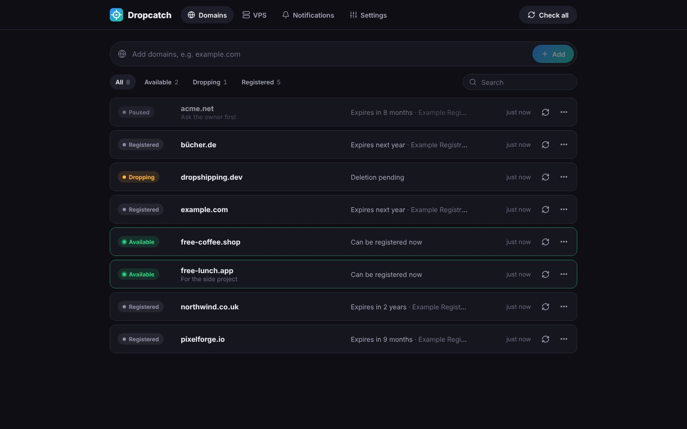

## Features

- **Watch domains**: add several at once (`example.com example.net`), with an optional note; pause, resume or remove them. Internationalised names (`bücher.de`) and pasted URLs work; subdomains are reduced to the registered domain.
- **Registration status**: registered, dropping (expired, in the redemption or pending delete period) or available, with the registrar, registration and expiry dates, the registry's status codes and a history of status changes
- **Watch OVHcloud VPS**: choose the OVH shop (country), a plan from OVH's catalog (with its specifications and price) and any datacenter, whole regions (Europe, North America, Asia-Pacific) or individual datacenters. See the current stock of every datacenter, with a link to order, and when each datacenter had stock, on a timeline and in a table.
- **Periodic checks** at an interval you choose (5 minutes to 7 days), and more often (every 2 minutes by default) while a VPS is in stock, one query at a time so that registries and OVH do not rate-limit you; check one or everything on demand
- **Notifications** through any [Apprise URL](https://github.com/caronc/apprise/wiki#notification-services): ntfy, Telegram, Discord, Slack, Pushover, Gotify, e-mail and many more. Send a test from the UI. Optionally also notified when a domain enters its deletion period, is restored by its owner or is registered again, and when a VPS sells out again.
- **Live updates**: check results appear without reloading
- **Install** on a phone's home screen or as a desktop app
- **Security**: password login with signed session cookies, rate-limited login attempts, CSRF protection

## Screenshots

| VPS | Watching a VPS |
|---|---|
| 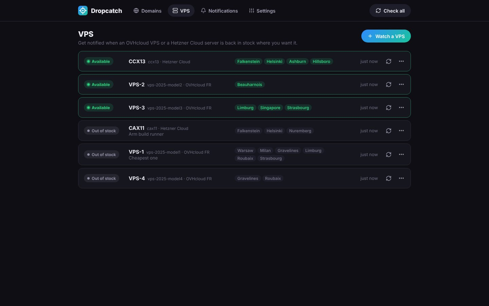 | 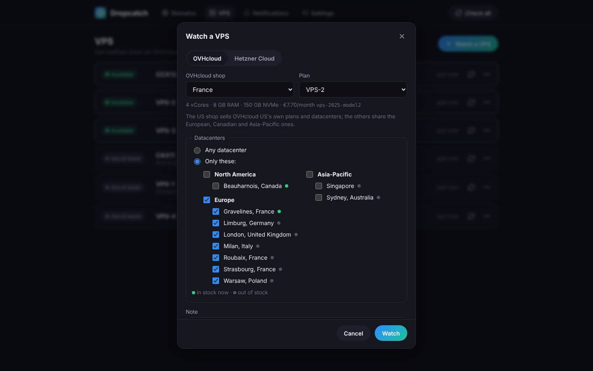 |
| **Domain details** | **VPS stock** |
| 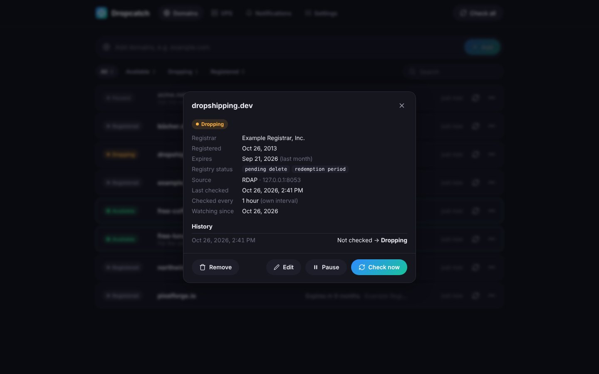 | 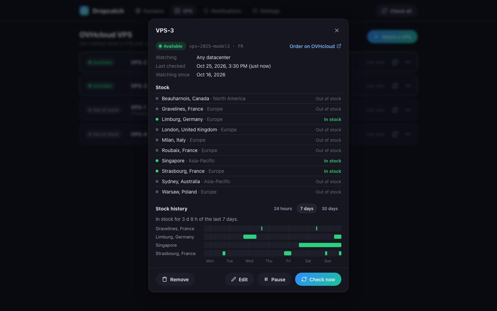 |
| **Notification targets** | **Settings** |
| 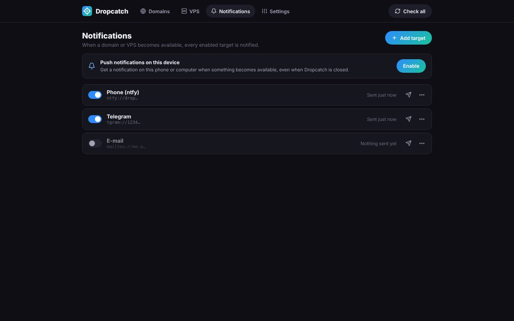 | 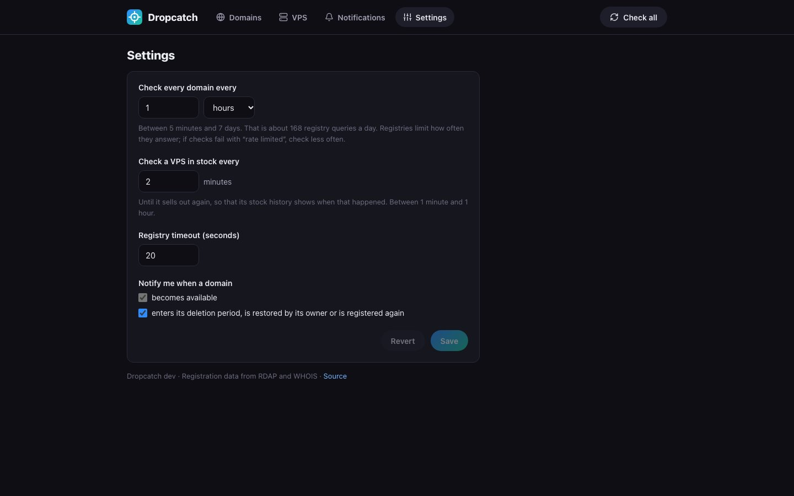 |
| **Light theme** | |
| 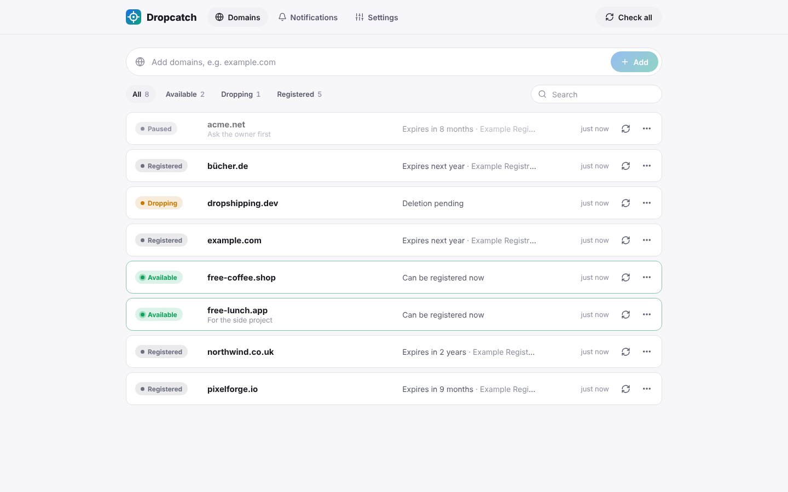 | |

<p>
  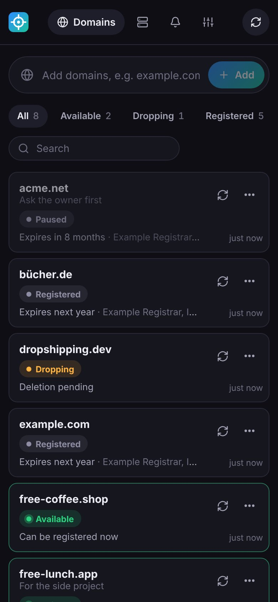
  &nbsp;
  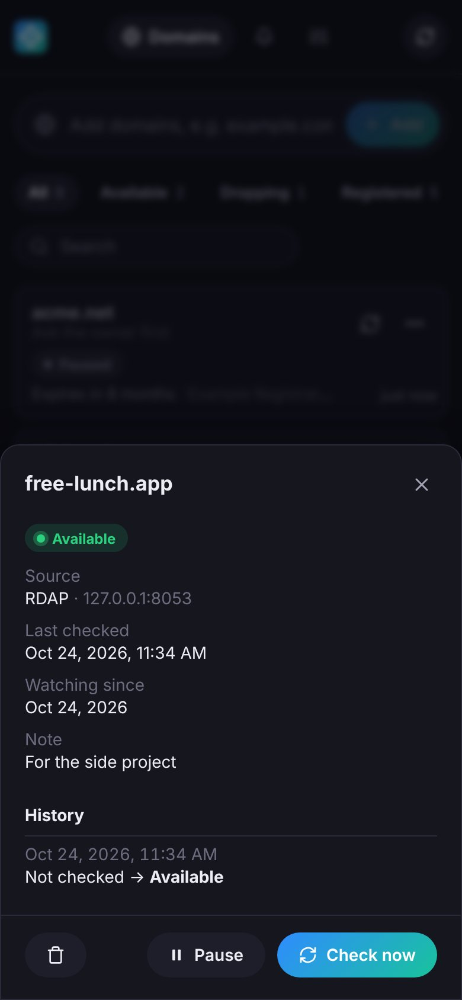
  &nbsp;
  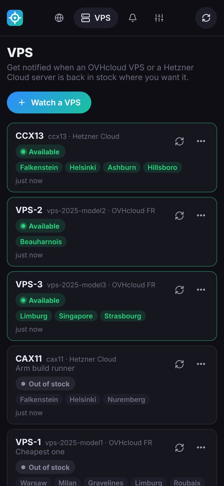
</p>

The screenshots are generated against a fake registry and OVH API with `make screenshots` (see [Development](#development)).

## How it works

### Domains

Dropcatch asks the registry of each domain's TLD:

1. Over **RDAP**, the JSON protocol that ICANN requires of every gTLD registry and that many ccTLDs offer. The server of each TLD comes from the [IANA bootstrap file](https://data.iana.org/rdap/dns.json). "Not found" means the domain is available.
2. Over **WHOIS** for TLDs without RDAP (several ccTLDs, such as `.be`), using the server that `whois.iana.org` lists. The answer is matched against the phrases registries use for unregistered names.

A domain whose registry status includes *pending delete* or *redemption period* (or `QUARANTINE` in WHOIS) is shown as **dropping**: its registration expired and the registry deletes it at the end of that period, unless the owner restores it. When the status changes to **available**, every enabled notification target is notified, once.

### OVHcloud VPS

Dropcatch reads OVH's public API, which needs no OVH account: the stock of a plan comes from `/vps/order/rule/datacenter`, which lists every datacenter that offers it as available or out of stock, and the plans from the public order catalog. Both depend on the OVH shop (`FR`, `DE`, `CA`, `US`, …), which also picks the API: `eu.api.ovh.com`, `ca.api.ovh.com`, or `api.us.ovhcloud.com` for OVHcloud US, which has its own plans and datacenters.

A plan counts as in stock in a datacenter when both the plan and its Linux images are available there. A watch is **available** when at least one datacenter it watches has stock. Every time stock appears in a watched datacenter that had none, every enabled notification target is notified with the datacenters and a link to order.

While a watch is available, it is checked more often (every 2 minutes by default, set in the settings) until it sells out again, so that its stock history shows how long the stock lasted. The history records, for every datacenter that offers the plan, when it had stock: from the first check that saw the stock to the first that did not. The last 100 periods are kept.

### Checks

Domains and VPS share one schedule and one interval, except that a VPS in stock is checked at the shorter in-stock interval. Checks run one at a time, with a two-second pause in between. A failed check (timeout, rate limit) keeps the last known status and is shown on the domain or VPS; it does not send a notification.

## Quick start (Docker)

```sh
docker run -d --name dropcatch -p 8080:8080 \
  -v dropcatch-data:/data \
  -e DROPCATCH_PASSWORD=change-me \
  ghcr.io/floriandejonckheere/dropcatch:main
```

Then open <http://localhost:8080>, add domains, and add a notification target under **Notifications**. The image includes Apprise.

### User and group

Dropcatch runs as the user and group given by `PUID` and `PGID` (default `1000`). On start, the container makes the data directory writable for that user and then drops root privileges.

Alternatively, run the container directly as a user (`--user 1000:1000` or `user:` in Compose). The data volume must then already be writable by that user.

To build the image yourself instead: `docker build -t dropcatch .`

## Docker Compose

A ready-made [`docker-compose.yml`](docker-compose.yml) uses the image published from `main` (`ghcr.io/floriandejonckheere/dropcatch:main`):

```yaml
services:
  dropcatch:
    image: ghcr.io/floriandejonckheere/dropcatch:main
    container_name: dropcatch
    restart: unless-stopped
    ports:
      - "8080:8080"
    volumes:
      - dropcatch-data:/data          # domains, targets, settings
    environment:
      DROPCATCH_PASSWORD: change-me   # or DROPCATCH_PASSWORD_HASH (bcrypt)
      # DROPCATCH_USERNAME: admin

volumes:
  dropcatch-data:
```

Change the password, then run `docker compose up -d`. Update with `docker compose pull && docker compose up -d`.

## Running from source

Requirements: Go 1.27+ and Node 22+. The [Apprise CLI](https://github.com/caronc/apprise#installation) (`pip install apprise`) is needed to send notifications.

```sh
make build                     # builds the web UI and the ./dropcatch binary
DROPCATCH_PASSWORD=change-me ./dropcatch --data-dir ./data
```

For frontend development, also run `cd web && npm run dev`. Vite proxies `/api` to the server on port 8080.

## Development

| Command | What it does |
|---|---|
| `make test` | `go vet` and the Go tests |
| `make check` | `make test` plus the frontend type check |
| `make build` | Builds the web UI and the `./dropcatch` binary |
| `make fakeregistry` | Runs a fake RDAP registry and OVH API on port 8053 for local testing |
| `make screenshots` | Regenerates `docs/screenshots` |

The fake registry answers for common TLDs: names starting with `free` are available, names starting with `drop` are pending deletion, and all others are registered. It also offers four VPS plans: VPS-1 is out of stock everywhere (until `--restock-after`, if given, then in Roubaix; with `--restock-for`, it sells out again after that long, and restocks again and again), and the others have stock in some datacenters. Point Dropcatch at it with `--rdap-bootstrap http://127.0.0.1:8053/dns.json --ovh-api http://127.0.0.1:8053/v1`. `make screenshots` needs Playwright's Chromium (`cd web && npx playwright install chromium`, or set `CHROMIUM_PATH`). Regenerate the screenshots whenever the UI changes.

Instructions for coding agents are in [AGENTS.md](AGENTS.md).

## Configuration

These are set when starting Dropcatch; the check interval and notifications are configured in the web UI. Every flag can also be set as an environment variable (`--data-dir` → `DROPCATCH_DATA_DIR`). Flags take precedence.

| Flag | Default | Description |
|---|---|---|
| `--data-dir` | `$XDG_CONFIG_HOME/dropcatch` (`/data` in Docker) | Where the domains, notification targets, settings and session key are stored |
| `--listen` | `:8080` | Address to listen on |
| `--base-path` | `/` | URL prefix when served behind a reverse proxy (e.g. `/dropcatch`) |
| `--password` | | Enables login with this password |
| `--password-hash` | | Enables login with a bcrypt hash instead of a plain password |
| `--username` | | Also require this user name at login |
| `--secret` | generated | Key for signing session cookies. Set it to keep sessions valid when the data directory is replaced |
| `--password-file`, `--password-hash-file`, `--secret-file` | | Read the value from a file instead, such as a Docker secret |
| `--apprise` | auto-detected on `PATH` | Path to the Apprise CLI |
| `--rdap-bootstrap` | `https://data.iana.org/rdap/dns.json` | RDAP bootstrap file that lists the RDAP server of each TLD |
| `--ovh-api` | the API of each OVH shop | Base URL of the OVH API (such as `https://eu.api.ovh.com/v1`), for all shops |

In Docker, `PUID` and `PGID` (default `1000`) set the user and group Dropcatch runs as.

Without a password, anyone who can reach Dropcatch can see and change your domains and notification URLs; it logs a warning at startup. Pass the password and secret through environment variables or files rather than command-line flags, which other users on the host can see in the process list. To create a bcrypt hash: `htpasswd -bnBC 10 "" 'your-password' | tr -d ':\n'`.

## Data

Everything is stored in `dropcatch.json` in the data directory (readable by its owner only, as notification URLs often contain tokens), next to the session key and the list of logged-out sessions. Each change rewrites the file through a temporary file and a rename, so it is never left half-written. Back it up by copying the directory.
